<h3><code>mayank@github ~ $ ./contributions.sh</code></h3>

  

<h3><code>mayank@github ~ $ whoami</code></h3>
<table>
  <tr>
    <td valign="top"></td>
    <td valign="top"></td>
  </tr>
</table>

 

<h3><code>mayank@github ~ $ ls ~/projects</code></h3>
<table>
  <tr>
    <td width="430" valign="top"><a href="https://github.com/imayankss/SecureSwipe"><b>SecureSwipe</b></a> · <a href="https://secure-swipe.vercel.app">live</a> Capacity-aware fraud-risk manager: ranks suspicious card transactions under a fixed review budget and returns bounded, auditable decisions.</td>
    <td width="430" valign="top"><a href="https://github.com/imayankss/reliability-aware-on-device-summarization"><b>On-device summarization</b></a> Evidence-first research on reliability-aware selection and abstention for on-device scientific-paper summarization.</td>
  </tr>
  <tr>
    <td valign="top"><a href="https://github.com/imayankss/CASA-forecasting"><b>CASA Forecasting</b></a> Time-series forecasting and analytics for Current Account / Savings Account trends with ML and statistical models.</td>
    <td valign="top"><a href="https://github.com/imayankss/bank_lead_scoring"><b>Bank Lead Scoring</b></a> Retail-banking lead scoring and CLTV on synthetic customer-360 data: dbt ELT, ML models, FastAPI + Streamlit CRM views.</td>
  </tr>
</table>

 

&nbsp;

